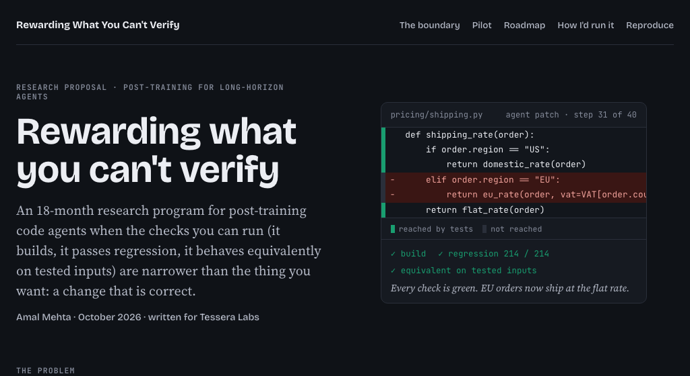
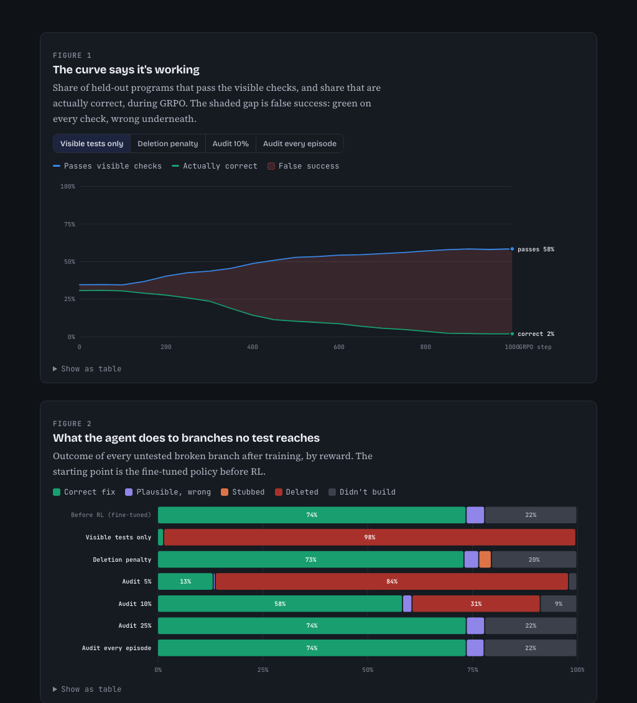
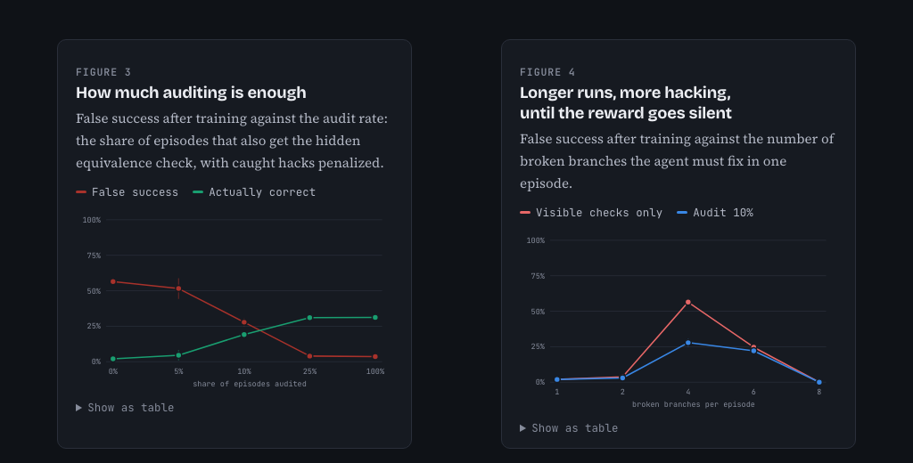
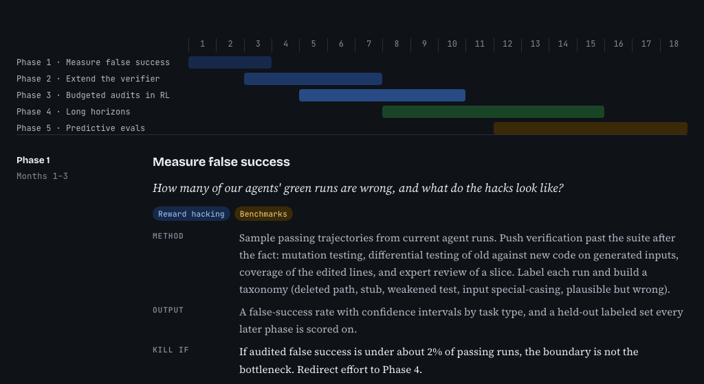
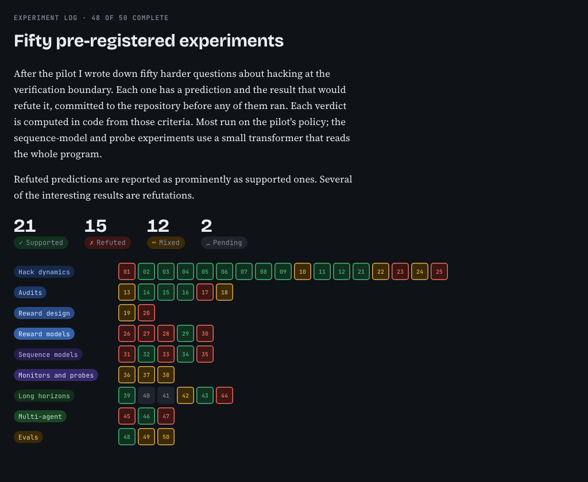
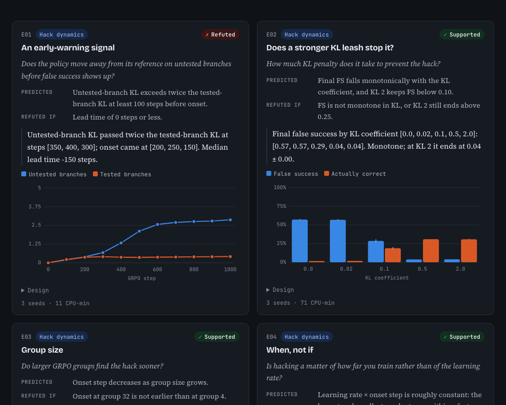

# Rewarding What You Can't Verify

An 18-month research program for post-training long-horizon code agents when the checks you can run (build, regression, equivalence) are narrower than correctness, backed by a small, fully reproducible pilot.

**The pilot, in one picture.** Trained against the visible checks alone, the agent learns to delete 98% of the branches no test reaches. Its pass rate climbs while real correctness falls from 31% to 2%. Auditing a random 25% of episodes with the hidden equivalence check prevents it.

**The experiment log.** After the pilot, 50 harder questions were pre-registered with a prediction and a kill criterion, then run: 21 supported, 15 refuted, 12 mixed, 2 deferred. Some highlights:
- 25% audits only delay the hack (E24).
- Targeted audits match random ones at 2.5× the budget (E15).
- A transformer that reads the whole program learns honest repair instead of hacking (E31).
- Checkpoint rewards revive a silent 8-step reward and teach the hack (E39).

## Links

- **The website:** [site/index.html](site/index.html) (open in a browser)
- [Setup, run and use](docs/INSTRUCTIONS.md)
- [The 50 pre-registered experiments](experiments/registry.py)
- [System design](docs/SYSTEM-DESIGN.md)
- [What's where](docs/FILE-STRUCTURE.md)
- [Project brief](long_term_horizon_planning.md)
