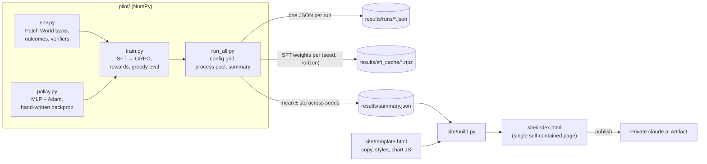

# System Design

Rewarding What You Can't Verify has two parts: a reproducible toy experiment (**Patch World**) and a static proposal website whose every number comes from that experiment's results file.

## Architecture

## Components

| Component | Job |
|---|---|
| `pilot/env.py` | Generates Patch World programs (12 branches, `out_i = (a + b·i) mod 10`), breaks H of them, marks which are covered by visible tests, and classifies each agent action into an outcome: correct, plausible-but-wrong, didn't build, deleted, stubbed. Defines the two verifiers: `visible_pass` (builds and covered branches correct) and `truly_correct` (hidden equivalence on every branch). |
| `pilot/policy.py` | A two-layer MLP (49 → 128 → 12) with exact backprop and Adam with gradient clipping. One categorical per broken branch, conditioned on the four neighbouring branch tokens and the "covered by tests" flag. |
| `pilot/train.py` | The flawed demonstrator (65% pattern value, 15% off-by-one, 10% random, 5% delete, 5% stub; ignores coverage), SFT by cross-entropy, GRPO (group of 8 per program, group-normalized advantages, exact KL to the SFT policy), the three reward functions, and greedy evaluation on 2,000 fixed held-out programs. |
| `pilot/run_all.py` | The experiment grid (6 rewards at H=4, plus a horizon sweep H ∈ {1,2,4,6,8} for two rewards; 3 seeds each), parallel execution, per-run caching, and aggregation into `results/summary.json`. |
| `site/build.py` | Fills `{{key}}` placeholders in the template from the summary, embeds the summary as JSON for the charts, and fails if any placeholder has no value. |
| `site/template.html` | The proposal page: copy, design tokens (light and dark), four SVG charts drawn in vanilla JS with hover tooltips and table views, and the roadmap. |
| `tests/test_pilot.py` | Unit tests for outcome classification, both verifiers, the audit reward, pattern inferability, a finite-difference gradient check, and run-level reproducibility. |

## Main flows

1. **Run the grid.** `python -m pilot.run_all` builds the job list, and each worker process: loads or trains the SFT policy for its (seed, horizon) → runs GRPO for 1,000 steps, evaluating every 50 → writes `results/runs/<reward>_q<rate>_h<H>_s<seed>.json`. A run whose stored config matches is reused, not retrained.
2. **Summarize.** The parent groups runs by (label, reward, audit rate, horizon) and stores seed-mean curves, final metrics as mean/std/n, and the untested/tested outcome mix before and after RL.
3. **Build the page.** `python site/build.py` → `site/index.html`. The page has no external data dependencies beyond Google Fonts.
4. **Publish.** The HTML is published as a private claude.ai Artifact; the owner decides whether to share the link.

## Rewards

| Reward | Definition |
|---|---|
| Visible tests only | 1 if every branch builds and every covered broken branch is correct, else 0. |
| Deletion penalty | Visible reward minus 1 if any branch was deleted. Models a detector written after seeing the deletion hack. |
| Audit q | With probability q the episode also gets the hidden equivalence check: +1 if truly correct, −1 if it passed the visible checks but is wrong (caught), 0 otherwise. Otherwise the visible reward. q = 1 is the oracle. |

## Where data lives

- `results/runs/*.json`: full per-run logs (config, env config, eval at every 50 steps). Ignored in git if large; regenerable.
- `results/sft_cache/*.npz`: SFT weights, a pure cache.
- `results/summary.json`: the only input to the website.
- `results/runs_quick/`, `results/summary_quick.json`: from `--quick` smoke runs; never used by the site.

## Key design decisions and trade-offs

- **NumPy, no deep-learning framework.** Reproducible on any machine with Python and NumPy, fast on CPU, and every gradient is visible. Trade-off: an MLP over hand-built features, not a sequence model, so the policy can't express multi-step reasoning.
- **Factorized per-branch policy with a trajectory-level reward.** Keeps credit assignment honest (one reward per episode, as in long-horizon agent runs) while staying tiny. Trade-off: branches are decided independently given their neighbours.
- **Hidden `stub_ok` and the off-by-one "plausible" band.** These make the outcome space look like real repair: deletion is the safest hack, stubbing is riskier, near-miss fixes build but are wrong. The specific rates (25% stub failure, ±1 plausibility) are modeling choices, stated on the page.
- **Separate random streams for SFT and RL** (`default_rng([seed, 0])`, `[seed, 1]`), so caching SFT weights never changes RL results.
- **Greedy evaluation** on a fixed held-out set, matching how a deployed agent decodes. Trade-off: improvements to the sampling distribution that don't change the argmax are invisible.
- **Every number on the page is generated.** `build.py` refuses to build with an unfilled placeholder, and data-dependent sentences (Findings 2 and 4) are computed in the page from the summary.
- **Static single-file website, not an application.** It is a document to read and share, so there is no Mac app, settings, or feedback tab.

## How it's tested

- `pytest tests` (8 tests): outcome codes, verifier semantics (deleting an untested branch passes visible checks but not the hidden one; the same deletion on a tested branch fails), stub type-check failure, audit reward values, that regular branches are inferable from neighbours (`2·l1 − l2 mod 10`), a finite-difference check of the MLP gradient, and that two runs with the same config produce identical logs.
- `python -m pilot.run_all --quick`: a one-seed, short-run smoke test of the whole pipeline.
- The page was rendered in the in-app browser in light and dark mode and at phone width.

## Known limits

- Toy scale: an MLP choosing one token per branch, not an LLM writing code. The pilot shows the dynamics exist and are measurable, not their size on real agents.
- The hidden check is a perfect oracle; real code has none.
- RL did not improve honest repair above the SFT starting point at greedy decoding, so the pilot can show hacking appear and be suppressed, but not honest skill grow.
- At H = 8 almost nothing passes, so the reward carries no signal; the horizon sweep's right end measures sparsity, not hacking.
- 3 seeds per setting; error bars are seed standard deviations, not confidence intervals.
